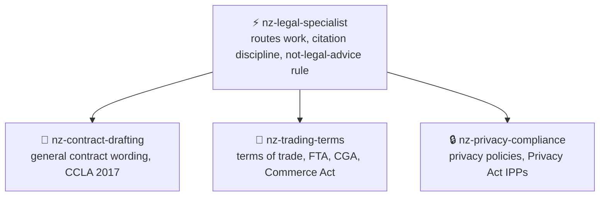

```
███╗   ██╗███████╗    ██╗     ███████╗ ██████╗  █████╗ ██╗
████╗  ██║╚══███╔╝    ██║     ██╔════╝██╔════╝ ██╔══██╗██║
██╔██╗ ██║  ███╔╝     ██║     █████╗  ██║  ███╗███████║██║
██║╚██╗██║ ███╔╝      ██║     ██╔══╝  ██║   ██║██╔══██║██║
██║ ╚████║███████╗    ███████╗███████╗╚██████╔╝██║  ██║███████╗
╚═╝  ╚═══╝╚══════╝    ╚══════╝╚══════╝ ╚═════╝ ╚═╝  ╚═╝╚══════╝

███████╗██████╗ ███████╗ ██████╗██╗ █████╗ ██╗     ██╗███████╗████████╗
██╔════╝██╔══██╗██╔════╝██╔════╝██║██╔══██╗██║     ██║██╔════╝╚══██╔══╝
███████╗██████╔╝█████╗  ██║     ██║███████║██║     ██║███████╗   ██║
╚════██║██╔═══╝ ██╔══╝  ██║     ██║██╔══██║██║     ██║╚════██║   ██║
███████║██║     ███████╗╚██████╗██║██║  ██║███████╗██║███████║   ██║
╚══════╝╚═╝     ╚══════╝ ╚═════╝╚═╝╚═╝  ╚═╝╚══════╝╚═╝╚══════╝   ╚═╝
```

<div align="center">

# ⚡ NZ Legal Specialist

**Drafts and reviews New Zealand business contract, terms of trade and privacy wording, citing the Act and section for every flagged issue, for any agent.**

[](https://github.com/KinwiseNZ-DevOps/nz-legal-specialist/actions/workflows/validate.yml)
[](LICENSE)
[](https://agentskills.io)
[](https://agentskills.io/specification)
[](scripts/skills_tool.py)

</div>

Table of contents:

- [Skills](#skills)
- [How they fit together](#how-they-fit-together)
- [Install](#install)
- [Usage](#usage)
- [Optional agent profiles](#optional-agent-profiles)
- [Validate](#validate)
- [Layout](#layout)
- [Status and limits](#status-and-limits)

---

> [!IMPORTANT]
> **Principle: every flagged wording issue names a specific New Zealand Act and section; no citation means no flag, and this is drafting support, not legal advice.**

These skills check the wording of business contracts, terms of trade and privacy policies against New Zealand statute: the Contract and Commercial Law Act 2017, Fair Trading Act 1986, Consumer Guarantees Act 1993, Commerce Act 1986 and Privacy Act 2020. They are grounded in the current text of those Acts on [legislation.govt.nz](https://www.legislation.govt.nz) and in guidance from the Commerce Commission, the Office of the Privacy Commissioner and Consumer Protection (MBIE), and follow the open [Agent Skills](https://agentskills.io/specification) format. They work in Claude Code, Codex, Cursor, Copilot, OpenCode, or any SKILL.md-compatible agent.

---

<a id="skills"></a>
## 🧩 Skills

<!-- catalogue:begin -->
| Skill | Purpose |
|---|---|
| [`nz-contract-drafting`](skills/nz-contract-drafting/SKILL.md) | Checks wording against the Contract and Commercial Law Act 2017 and general contract law, clause by clause, with a section citation for every flagged issue. |
| [`nz-legal-specialist`](skills/nz-legal-specialist/SKILL.md) | Router and shared guardrails for New Zealand commercial legal drafting: requires a specific Act and section for every flagged issue, never invents a citation, and always states that output is not legal advice. |
| [`nz-privacy-compliance`](skills/nz-privacy-compliance/SKILL.md) | Checks wording against the Privacy Act 2020's Information Privacy Principles and breach notification duties, clause by clause, with a section citation for every flagged issue. |
| [`nz-trading-terms`](skills/nz-trading-terms/SKILL.md) | Checks wording against the Fair Trading Act 1986, Consumer Guarantees Act 1993 and Commerce Act 1986, clause by clause, with a section citation for every flagged issue. |
<!-- catalogue:end -->

---

<a id="how-they-fit-together"></a>
## 🗺️ How they fit together



Most reviews start at the router, which identifies the document type and audience, then hands off to one or more specialist skills; a sales agreement with trading and privacy clauses can use both.

---

<a id="install"></a>
## 📦 Install

> [!TIP]
> Install the router skill **plus every sibling skill it links to**; routers reference siblings by relative path.

**Claude Code plugin** (installs the skills and any agent profiles together):

```text
/plugin marketplace add KinwiseNZ-DevOps/nz-legal-specialist
/plugin install nz-legal-specialist@nz-legal-specialist-marketplace
```

**ChatGPT desktop plugin** (local, skills and bundled hooks):

This repo has a portable `plugin.json` manifest and a repo marketplace at `.agents/plugins/marketplace.json`. Open this repo as a trusted project and restart ChatGPT desktop, then install **NZ Legal Specialist** from the Plugins Directory. Review and trust bundled hook scripts before they run.

Or copy or symlink the `skills/` subfolders you want into your agent's skills directory:

| Agent | Where skills live |
|---|---|
| Claude Code | `~/.claude/skills/` or a project's `.claude/skills/` |
| Codex · Cursor · Copilot · OpenCode · Windsurf | the agent's own SKILL.md discovery path |

To install supplied Claude Code, GitHub Copilot or Codex profiles into a project, run `python scripts/install_agents.py --host claude-code --target PATH`. Each repo supplies one main workflow agent and may supply one helper per host. Other hosts receive the skills only. If no profile files are supplied for that host, it makes no changes.

---

### Always on

In Claude Code, NZ Legal Specialist loads a short ruleset into every session as soon as the plugin is installed (cite every flagged issue, verify before citing, state the not-legal-advice line, never contract out of a non-excludable right). It tells you its state at the start of each session and costs roughly 400 tokens.

| Mode | What it does |
|---|---|
| `on` | The rules apply in every session |
| `auto` (default) | The rules apply in every session; this plugin is not tied to a particular project type |
| `off` | The rules do not load |

- Say **"stop legal mode"** to pause it for the current session, and **"start legal mode"** to resume.
- Ask Claude to **set the saved mode to on, off or auto**. It writes that word into `~/.claude/.nz-legal-specialist.mode`. You can also edit that file yourself, and deleting it returns to the default (`auto`).
- It needs Node on the machine, because the start-up hook runs a small Node script. Without Node the hook quietly does nothing.
- Other agents have no start-up hook here. Paste `skills/nz-legal-specialist/references/always-on-rules.md` into that agent's instruction file instead.

### Safety checks

The same hooks run a few checks while you work. Each one only asks, warns or adds a reminder; none changes your files on its own.

| Check | What it does | On by default |
|---|---|---|
| `dangerGuard` | Asks before risky commands: force pushes, `git reset --hard`, `rm -r`, dropping data, `docker compose down -v`, publishing a package | Yes |
| `secretsGuard` | Asks before writing keys, tokens or `.env` files | Yes |
| `packageGuard` | Asks if a package about to be installed does not exist on PyPI, npm or pub.dev, because the name may be invented | Yes |
| `licenseGuard` | Warns after installing an npm or PyPI package with a GPL-family licence | Yes |
| `editSecurity` | Reminds Claude about risky code it just wrote: `eval`, SQL built from strings, unescaped HTML, tokens in SharedPreferences | Yes |
| `promptGuard` | Warns when pasted text looks like it is trying to steer the agent | Yes |
| `verifyReminder` | Tells you at the end of a turn if code changed but no tests, lint or analysis ran | Yes |
| `linkGuard` | Warns about links that return "not found" in Markdown, HTML and JSX files written | No |
| `styleGuard` | Warns when a reply is over 200 words or uses an em or en dash (built for AI Kiwiniser's style) | No |
| `sessionLog` | Writes tool names and file names, never content, to `~/.claude/logs/nz-legal-specialist/` | No |
| `autoCommit` | Saves tracked changes as a local commit at the end of a turn. It never pushes | No |

Switch any check with `~/.claude/.nz-legal-specialist.features.json`, for example `{"packageGuard": false, "sessionLog": true}`, or ask Claude to write it. The saved mode (on, off or auto) applies to every check. If several of these plugins are installed, each risky action is checked once, not once per plugin.

Privacy: `packageGuard` and `licenseGuard` send package names, and `linkGuard` sends the links it checks, to the public registry or site. Nothing else leaves your machine. Turn those checks off if that is a concern.

<a id="usage"></a>
## 🚀 Usage

> [!TIP]
> **You never need to memorise skill names.** Just describe the problem in plain words; the router picks the right skill automatically. But if you want short, reliable phrases that always work, use these:

**The flow** (this is all most people need):

```text
1. "Review this contract under NZ law"      → Clause-by-clause review, each issue cited to an Act and section
2. "Check our terms of trade"               → Fair trading, unfair terms and consumer guarantee review
3. "Write/check our privacy policy"         → Information Privacy Principle review, matched to real data flows
```

**Short phrases that trigger each skill:**

| Just say… | What you get | Skill used |
|---|---|---|
| `Review this supply agreement` | Clause-by-clause contract review, citations to CCLA 2017 | *nz-contract-drafting* |
| `Check our sales terms for Fair Trading Act issues` | Review for misleading claims, unfair terms and guarantee wording | *nz-trading-terms* |
| `Write our privacy policy` | A policy built around your actual data flows, mapped to each IPP | *nz-privacy-compliance* |
| `Does this abide by the NZ Constitution?` | A correction on what actually governs the wording, then routing to the right skill | *nz-legal-specialist* |

> [!NOTE]
> Skills also trigger on their own when your request matches. In Claude Code you can also invoke one explicitly with `/<skill-name>`, but the plain phrases above are shorter and work across every agent.

---

<a id="optional-agent-profiles"></a>
## Optional agent profiles

This section applies only when agent definitions were supplied during setup. No agent profiles are supplied yet; all four skills run directly. See [AGENTS.md](AGENTS.md) for the dated note.

---

<a id="validate"></a>
## ✅ Validate

```bash
python scripts/skills_tool.py check
```

Checks: frontmatter, name/folder match, description length and trigger, body under 500 lines, every relative link resolves (including README.md and AGENTS.md), agent profile naming with no more than two profiles per host and exactly one `-workflow` main agent, agent `skills:` entries that exist and no `skills/<name>/SKILL.md` paths in agent bodies, plugin manifests (`.claude-plugin/plugin.json` and `marketplace.json`: required fields, licence matches `LICENSE`, `agents` lists every Claude Code profile, no top-level `agents/` folder), at least 3 eval cases per skill, catalogue freshness, no project-specific terms from `reference-content/strip-terms.txt`, and no em or en dashes in file names or in any text outside `reference-content/`. After the starter skill is deleted it also rejects leftover placeholders and setup-only paths that are tracked by Git or not ignored. Stdlib only, no dependencies.

---

<a id="layout"></a>
## 🗂️ Layout

<details>
<summary>Repository layout</summary>

```
skills/<name>/SKILL.md      one folder per skill (+ references/ where needed)
.claude-plugin/             plugin.json and marketplace.json (Claude Code plugin)
hooks/                      always-on rules and safety checks for Claude Code
evals/cases.jsonl           3+ behavioural cases per skill
evals/triggers.jsonl        triggering tests per skill: obvious, paraphrase, unrelated
resources/agents/             optional host profiles copied by installer
scripts/install_agents.py     copy optional agent profiles into a project
scripts/skills_tool.py      validate, regenerate catalogue (stdlib only)
.github/workflows/          CI runs `skills_tool.py check` (free on public repos)
AGENTS.md                   agent-facing rules for this repo
SETUP.md                    local checklist; ignored and kept off GitHub
reference-content/          private source material; ignored and kept off GitHub
templates/                  local skill scaffolding; ignored and kept off GitHub
```

</details>

---

<a id="status-and-limits"></a>
## 📌 Status and limits

> [!NOTE]
> - 29 October 2026: skills were authored from the current text of five Acts on legislation.govt.nz plus plain-language guidance (Consumer Protection, Commerce Commission, Office of the Privacy Commissioner, FinCap, Te Ara); none has been run against a real contract review yet. Reason: first draft awaiting real-world testing.
> - New Zealand law only; no other jurisdiction's citations are included. New Zealand has no single codified constitution; see [constitutional-framework.md](skills/nz-legal-specialist/references/constitutional-framework.md).
> - This is drafting support, not legal advice. Have a qualified New Zealand lawyer or Community Law check anything that creates real risk before relying on it.
> - Licensed under MIT (see [LICENSE](LICENSE)).

---

<div align="center">

**⚡ Built on the [Agent Skills](https://agentskills.io) open format · grounded in [New Zealand Legislation](https://www.legislation.govt.nz)**

</div>
